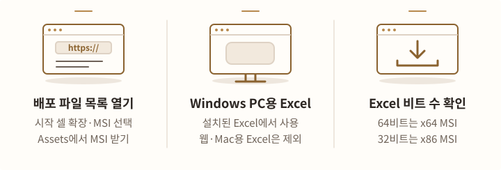
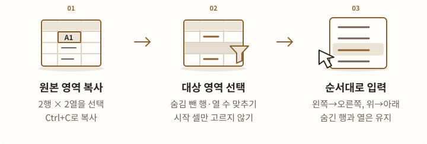
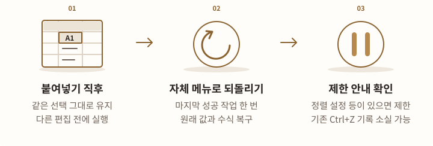

# 보이는 칸 붙여넣기 설치·사용

Excel에서 복사한 영역의 값을 **선택한 영역의 보이는 행·열에** 순서대로 넣습니다. 필터로 가려진 행과 숨긴 행·열은 건너뜁니다. 숨김을 뺀 원본과 대상의 행 수·열 수가 각각 다르면 아무 셀도 바꾸지 않습니다.

## 프로그램 받기 {#download}

<!-- tool-figure:visible-paste-download:start -->
<figure class="tool-figure">
  <picture>
    <source media="(max-width: 760px)" srcset="../../assets/tool-guides/visible-paste-download-mobile.svg" width="320" height="432">
    
  </picture>
  <figcaption>배포 목록에서 영역 붙여넣기·MSI 배포를 고르고 Excel 비트 수에 맞는 MSI를 받습니다.</figcaption>
</figure>
<!-- tool-figure:visible-paste-download:end -->

**보이는 칸 붙여넣기** · Windows PC에 설치된 Excel용 · 실행에 필요한 .NET Framework 4.8 사용

[배포 파일 목록](https://github.com/prozac0401/Workspace/releases){ .md-button .md-button--primary }

배포 목록에서 **보이는 칸 붙여넣기**의 영역 붙여넣기·MSI 배포를 선택합니다. 설치 파일이 모인 **Assets**에서 Excel 비트 수에 맞는 `.msi`를 받습니다. Excel 64비트에는 `x64`, Excel 32비트에는 `x86` 파일을 사용합니다. Excel의 **파일 → 계정 → Excel 정보**에서 비트 수를 확인할 수 있습니다.

웹용 Excel과 Mac용 Excel에서는 사용할 수 없습니다. 이전 배포의 한 행·한 열 제한이 있다면 영역 기능이 포함된 MSI를 선택하세요. 아래 [지원 범위](#supported)와 [되돌리기 조건](#undo)을 먼저 확인하세요.

## 설치하기 {#install}

<!-- tool-figure:visible-paste-install:start -->
<figure class="tool-figure">
  <picture>
    <source media="(max-width: 760px)" srcset="../../assets/tool-guides/visible-paste-install-mobile.svg" width="320" height="432">
    
  </picture>
  <figcaption>파일을 저장하고 Excel을 종료한 뒤 설치합니다. 이전 EXE·ZIP 또는 다른 MSI 버전은 먼저 제거합니다.</figcaption>
</figure>
<!-- tool-figure:visible-paste-install:end -->

1. 열려 있는 Excel 문서를 저장하고 모든 Excel을 종료합니다.
2. 기존 EXE·ZIP 또는 다른 MSI 버전으로 설치했다면 Windows **설치된 앱**에서 기존 **보이는 칸 붙여넣기**를 먼저 제거합니다.
3. Excel 비트 수에 맞는 **MSI**를 실행하고 설치 안내를 확인합니다.
4. 평소처럼 Excel을 실행합니다. 셀을 우클릭하면 **보이는 칸에 붙여넣기**와 **마지막 붙여넣기 되돌리기**가 나타납니다.

새 MSI는 기존 EXE·ZIP 설치를 자동으로 바꾸지 않습니다. 기존 설치를 먼저 제거하라는 안내가 나오면 해당 제품의 제거 절차를 마친 뒤 MSI를 다시 실행하세요.

현재 Windows 사용자 계정에 설치하며 MSI의 기본 위치는 `%LOCALAPPDATA%\Programs\VisibleCellsPaste`입니다. 관리자 권한이나 개발용 프로그램은 필요하지 않습니다. 명령을 직접 써 넣거나 따로 실행할 필요는 없습니다. 설치 후 Excel을 열면 사용할 준비가 됩니다.

설치 중 Excel이 실행 중이라는 안내가 나오면 설치를 멈춥니다. 화면에 창이 없어도 Excel이 뒤에서 실행 중이면 같은 안내가 나올 수 있습니다. 문서를 저장하고 Excel이 정상 종료된 뒤 다시 실행하세요. 설치 프로그램이 Excel을 강제로 닫지는 않습니다.

## 보이는 칸에 값 넣기 {#paste}

<!-- tool-figure:visible-paste-use:start -->
<figure class="tool-figure">
  <picture>
    <source media="(max-width: 760px)" srcset="../../assets/tool-guides/visible-paste-use-mobile.svg" width="320" height="432">
    
  </picture>
  <figcaption>원본과 대상의 보이는 행 수·열 수를 각각 맞춥니다. 빈칸의 위치와 순서를 유지하며 숨긴 행·열을 건너뜁니다.</figcaption>
</figure>
<!-- tool-figure:visible-paste-use:end -->

1. 원본 Excel에서 **연속된 사각형 영역**을 선택하고 **Ctrl+C**로 복사합니다. 한 행·한 열·한 셀도 가능하며 원본 Excel은 열어 둡니다.
2. 대상에서 값을 넣을 **연속된 사각형 영역 전체**를 선택합니다. 숨김·필터를 뺀 행 수와 열 수가 원본과 각각 같아야 합니다.
3. 선택한 범위 안을 우클릭하고 **보이는 칸에 붙여넣기**를 누릅니다.
4. 기존 수식을 덮어쓰거나 빈칸으로 내용을 지우는 경우에는 안내된 개수를 확인하고 진행합니다.

각 행은 왼쪽에서 오른쪽으로, 행은 위에서 아래로 대응합니다. 기존 한 행 원본을 한 열 대상에 위에서 아래로 넣는 방식도 사용할 수 있습니다. 스크롤 밖의 일반 셀은 숨긴 셀이 아니므로 대상에 포함됩니다.

예를 들어 보이는 원본이 첫 행 `85, 90`, 둘째 행 `78, 88`인 2행×2열이고, 대상 **E2:G4**에서 3행과 F열이 숨겨져 있다면 다음과 같이 들어갑니다.

| 대상 행 | E열 | 숨긴 F열 | G열 |
|---|---|---|---|
| 2행 | 85 | 기존 값 유지 | 90 |
| 숨긴 3행 | 기존 값 유지 | 기존 값 유지 | 기존 값 유지 |
| 4행 | 78 | 기존 값 유지 | 88 |

`2행×3열`을 `3행×2열`에 넣으면 총 칸 수가 같아도 모양이 달라 중단합니다. 빈칸도 한 칸으로 세며 자리를 유지합니다. 한 값을 반복하거나 시작 셀에서 선택 범위를 자동으로 늘리지 않습니다.

**복사한 순서대로 입력합니다.** 이름이나 사번을 찾아 연결하지 않습니다. 원본과 대상의 개수가 같아도 사람의 순서까지 일치한다는 뜻은 아닙니다.

## 값과 표시 형식 {#values}

<!-- tool-figure:visible-paste-values:start -->
<figure class="tool-figure">
  <picture>
    <source media="(max-width: 760px)" srcset="../../assets/tool-guides/visible-paste-values-mobile.svg" width="320" height="432">
    
  </picture>
  <figcaption>빈칸·숫자·문자열의 위치와 값을 보존합니다. 날짜 숫자와 대상 서식을 그대로 쓰므로 원본과 표시가 달라질 수 있습니다.</figcaption>
</figure>
<!-- tool-figure:visible-paste-values:end -->

- 숫자, 글자, 참·거짓, 빈칸과 지원하는 Excel 오류값을 처리합니다. `00123` 같은 글자 값, 긴 식별번호, 셀 안의 줄바꿈을 유지합니다.
- 수식은 **복사된 계산 결과**를 넣습니다. 수식 자체를 옮기거나 원본을 다시 계산하지 않습니다.
- 실제 빈칸도 한 항목으로 셉니다. 처음·가운데·마지막의 빈칸은 대응하는 대상의 내용을 비웁니다. 수식 `=""`처럼 아무 글자도 보이지 않는 결과도 한 항목으로 셉니다. 이 결과는 붙여넣을 때 실제 빈칸으로 저장될 수 있습니다.
- 대상의 숫자 표시 형식, 글꼴, 배경, 테두리와 조건부 서식을 유지합니다. 원본의 표시 형식을 복사하지 않습니다.
- 날짜·시간·백분율은 원래 숫자 값을 사용합니다. 복사 정보에서 날짜·시간의 숫자 값을 확인할 수 없으면 중단합니다. 대상의 표시 형식에 따라 보이는 모양은 달라질 수 있으며, 날짜를 숫자로 바꾸는 기준 연도가 1900년 또는 1904년으로 다를 때 그 차이를 자동으로 고치지는 않습니다.
- 실제 숫자 `123`이 표시 형식 때문에 `00123`으로 보이는 경우, 넣는 값은 숫자 `123`입니다. 글자 `00123`과는 다릅니다.

값의 종류나 빈칸을 포함한 개수를 읽을 수 없으면 중단합니다. 일반 텍스트를 숫자나 날짜로 추측해서 바꾸지 않습니다.

## 지원 범위 {#supported}

<!-- tool-figure:visible-paste-limits:start -->
<figure class="tool-figure">
  <picture>
    <source media="(max-width: 760px)" srcset="../../assets/tool-guides/visible-paste-limits-mobile.svg" width="320" height="432">
    
  </picture>
  <figcaption>지원하지 않는 범위는 쓰기 전에 중단합니다. 항목 수 외에도 선택 범위·복사 데이터 크기·보이는 구간 수의 상한이 있습니다.</figcaption>
</figure>
<!-- tool-figure:visible-paste-limits:end -->

원본은 Excel에서 **Ctrl+C로 복사한 연속 영역**이어야 합니다. 다른 Excel 파일이나 다른 Excel 창에서 복사할 수 있으며, 원본의 숨김은 복사 정보에 담긴 행·열 상태로 판단합니다. 대상도 연속 영역 전체를 선택하며 숨김을 뺀 행·열의 모양이 같아야 합니다. 원본 셀을 다시 읽거나 대상 크기에 맞춰 항목을 줄이지 않습니다.

다음 범위는 처리하지 않습니다.

- 잘라내기, 전체 행·열·시트 선택, 직접 만든 여러 영역 선택.
- 보이는 셀이 없는 영역, 보이는 행·열 모양이 다른 대상. 기존 한 행 원본→한 열 대상만 방향 전환을 허용합니다.
- 합쳐진 칸, 여러 칸에 결과를 함께 표시하는 수식, 자료를 모아 합계·평균 등으로 요약하는 표, 입력할 값을 제한하는 규칙이 있는 대상.
- 수정을 막아 둔 시트, 읽기 전용 파일, **제한된 보기**, 여러 시트를 함께 선택한 상태.
- 웹 표·일반 텍스트·그림·파일 복사, 지원하지 않는 새로운 오류 종류(예: `#SPILL!`, `#CALC!`).

표에서는 값만 있는 데이터 열을 사용합니다. 수정할 표 열의 숨긴 행에 수식이 있어도 중단합니다. 수정하지 않는 숨긴 계산 열은 별도의 보이는 값 열 작업을 막지 않습니다. 일반 셀의 기존 수식을 값으로 바꿀 때는 실행 전에 확인합니다. 다른 프로그램이나 추가 기능의 셀·행·정렬 변경이 끝난 뒤 실행하세요.

한 번에 원본과 보이는 대상 각각 **50,000개**, 선택 범위 **200,000칸**, 숨김으로 나뉜 구간 **20,000개**, 복사한 내용 **32 MiB**까지 처리합니다. 복사 정보에 숨김 셀이 포함되면 숨김 제거 전 원본 행×열도 50,000칸 이하여야 합니다. 5,000칸 또는 1,000구간부터 진행 여부를 확인합니다. 숨긴 행·열로 구간이 나뉘면 같은 개수의 연속 범위보다 오래 걸릴 수 있습니다.

## 마지막 작업 되돌리기 {#undo}

<!-- tool-figure:visible-paste-undo:start -->
<figure class="tool-figure">
  <picture>
    <source media="(max-width: 760px)" srcset="../../assets/tool-guides/visible-paste-undo-mobile.svg" width="320" height="432">
    
  </picture>
  <figcaption>최근 한 번만 자체 메뉴로 되돌립니다. 선택·편집·정렬 상태 등에 따라 제한되며, 파일을 닫은 뒤에는 복구할 수 없습니다.</figcaption>
</figure>
<!-- tool-figure:visible-paste-undo:end -->

붙여넣은 직후 **같은 범위를 유지한 채** 우클릭하고 **마지막 붙여넣기 되돌리기**를 누릅니다. 이 도구로 마지막에 성공한 작업 한 번의 값과 수식을 복원합니다.

되돌릴 기록은 현재 Excel이 켜져 있는 동안만 보관합니다. 다음 상황에서는 되돌리기가 제한됩니다.

- 선택 범위·시트·Excel 파일을 바꾸거나 셀을 편집한 뒤.
- 행 삽입·삭제·정렬 등 구조를 바꾸거나 파일을 닫은 뒤.
- Excel을 다시 시작했거나 원래 붙여넣은 위치를 확인할 수 없을 때.
- **기존 정렬 설정이 남아 있는 시트 또는 표.** 이 경우 방금 붙여넣었어도 되돌리기를 제공하지 않습니다.

이 도구로 값을 쓰면 Excel의 기존 **Ctrl+Z 기록이 지워질 수 있습니다.** 방금 실행한 작업은 이 도구의 **마지막 붙여넣기 되돌리기** 메뉴로 복구하세요. 파일을 닫은 뒤에도 남는 백업 기능은 아닙니다.

쓰기 도중 문제가 생기면 작업 전 상태로 복구를 시도합니다. 복구를 끝까지 확인하지 못하면 영향 범위와 오류를 알리고 후속 붙여넣기를 막습니다. 프로그램이 파일을 자동 저장하지 않으므로 안내를 확인하고 원본과 비교하세요.

## 업데이트·제거 {#remove}

<!-- tool-figure:visible-paste-maintenance:start -->
<figure class="tool-figure">
  <picture>
    <source media="(max-width: 760px)" srcset="../../assets/tool-guides/visible-paste-maintenance-mobile.svg" width="320" height="432">
    
  </picture>
  <figcaption>업데이트와 제거 전에 Excel을 저장하고 종료하세요. 이 도구의 자동 로드 등록과 소유 파일을 정리합니다.</figcaption>
</figure>
<!-- tool-figure:visible-paste-maintenance:end -->

다른 MSI 버전으로 바꿀 때는 Excel을 저장·종료하고 기존 제품을 먼저 제거한 뒤 새 MSI를 실행합니다. 이전 EXE·ZIP 설치도 먼저 제거합니다. 새 MSI는 다른 버전의 설치를 자동으로 덮어쓰지 않습니다.

제거할 때는 Excel을 저장·종료한 뒤 Windows의 **설치된 앱**에서 **보이는 칸 붙여넣기**를 제거합니다. 이전 EXE·ZIP은 당시 배포물의 제거 방법을 사용합니다. 이 도구의 자동 실행 설정과 프로그램 파일만 정리하며 Excel 파일, 다른 추가 기능, PERSONAL.XLSB와 Office 보안 설정은 지우지 않습니다.

MSI가 설치한 파일이나 등록 값이 외부에서 바뀌면 복구·제거를 중단합니다. 추가 기능을 비활성화한 경우에도 해당할 수 있습니다. 안내된 항목을 확인하고, 다른 프로그램이나 사용자가 추가한 파일·등록 값을 강제로 지우지 마세요.

## 막혔을 때 {#help}

<!-- tool-figure:visible-paste-troubleshooting:start -->
<figure class="tool-figure">
  <picture>
    <source media="(max-width: 760px)" srcset="../../assets/tool-guides/visible-paste-troubleshooting-mobile.svg" width="320" height="432">
    
  </picture>
  <figcaption>안내 문구에 맞춰 선택 범위와 복사한 내용을 확인하세요. 문의할 때는 선택한 범위와 안내 문구를 적어 주세요.</figcaption>
</figure>
<!-- tool-figure:visible-paste-troubleshooting:end -->

| 안내 또는 상황 | 다음에 할 일 |
|---|---|
| 메뉴가 없어요 | Excel을 완전히 종료한 뒤 다시 여세요. Excel의 **파일 → 옵션 → 추가 기능 → 관리: COM 추가 기능**에서 **보이는 칸 붙여넣기**를 확인하세요. |
| 원본과 대상 모양이 다르대요 | 숨김을 뺀 원본과 대상의 행 수·열 수를 각각 맞추세요. 빈칸도 한 칸으로 셉니다. |
| 복사 내용을 읽을 수 없대요 | 원본 Excel을 열어 둔 채 연속 영역을 Ctrl+C로 다시 복사하세요. 지원 범위와 복사 형식을 확정할 수 없으면 쓰지 않고 중단합니다. |
| 표나 셀을 처리할 수 없대요 | 병합, 보호, 입력할 값을 제한하는 규칙, 여러 셀에 결과를 함께 표시하는 수식과 표 열의 수식 여부를 확인하세요. |
| 되돌리기를 할 수 없대요 | 선택·편집·정렬·파일 전환 여부와 기존 정렬 설정을 확인하세요. 조건이 달라졌으면 도구가 이전 위치에 강제로 쓰지 않습니다. |
| 설치·제거가 중단돼요 | Excel 종료, 기존 설치 제거 여부, Excel 비트 수와 MSI 일치 여부를 확인하세요. 파일·등록 변경 안내가 있으면 해당 항목을 먼저 확인하세요. |
| 설치 실패 뒤 제품이 남아 있어요 | Excel을 종료하고 Windows **설치된 앱**에서 이 제품을 제거한 뒤 다시 설치하세요. 제거도 중단되면 표시된 오류와 설치 기록을 함께 문의하세요. |

문의할 때는 Windows·Excel 버전, 실행 순서와 오류 표시를 알려 주세요. 이 도구는 외부 서비스에 연결하거나 사용 통계를 보내지 않습니다.
